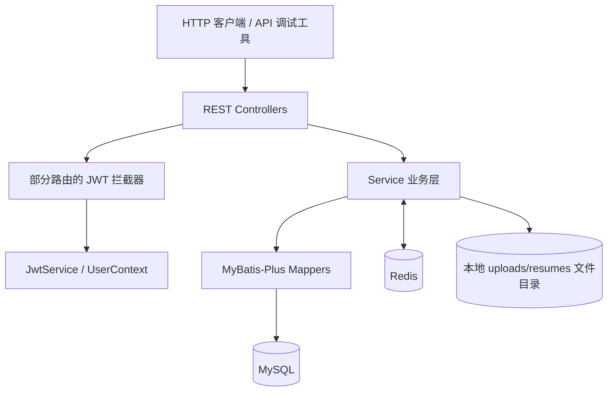

# CareerHub｜求职岗位与简历管理后端

> **版本状态：v1.0 发布候选版（Release Candidate）** · Maven 项目版本：`1.0-SNAPSHOT`  
> 一个以 Java、Spring Boot 为核心的求职管理后端实践项目，围绕用户、岗位、简历与认证构建 REST API，并通过 Redis 缓存、自动化测试和性能对照实验提升工程质量。

## 目录

- [项目介绍](#项目介绍)
- [核心功能](#核心功能)
- [技术栈](#技术栈)
- [系统架构](#系统架构)
- [技术设计要点](#技术设计要点)
- [主要 API](#主要-api)
- [数据库与项目结构](#数据库与项目结构)
- [本地启动](#本地启动)
- [自动化测试](#自动化测试)
- [性能测试与优化](#性能测试与优化)
- [当前限制与后续规划](#当前限制与后续规划)

## 项目介绍

CareerHub 面向求职管理场景，提供用户信息管理、岗位检索、简历文件管理和基础认证能力。项目按 Controller → Service → Mapper 分层组织，使用 MyBatis-Plus 访问 MySQL，并在岗位详情查询中使用 Redis 实现 Cache Aside 缓存策略。

目前已完成后端核心功能与 Service 层自动化测试，可在本地进行接口演示。**CareerAI（LLM / 简历智能分析等）属于后续规划，尚不是本版本已交付功能。** 本仓库也不以已完成 Docker 部署或生产环境上线作为当前状态。

## 核心功能

| 模块 | 已实现的主要能力 |
| --- | --- |
| 用户管理 | 用户创建、按 ID 查询、更新、删除；条件查询与分页 |
| 身份认证 | 用户注册、登录、密码编码、JWT 签发与解析；当前用户资料接口的令牌校验 |
| 岗位管理 | 岗位详情查询、创建/更新/删除、关键字与状态筛选、分页；岗位数量统计 |
| Redis 缓存 | 岗位详情 Cache Aside、10 分钟 TTL、更新/删除时缓存失效、异常时回源处理 |
| 简历管理 | PDF 文件上传、简历记录持久化、查询与删除、所属用户权限检查 |
| 验证码 | 基于 Redis 的邮箱验证码业务逻辑；实际邮件投递能力以运行环境与当前实现为准 |
| 工程质量 | 参数校验、业务异常处理、部分接口统一响应包装、自动化测试、性能基线与优化记录 |

> **权限范围说明：** 当前项目存在 `AuthInterceptor` 和 `UserContext`。不同路由的拦截器注册范围及简历接口的授权链路，应以最新 `WebConfig`、Controller 和实际 HTTP 验证为准；不要将此表理解为“全部接口已经统一强制鉴权”。

## 技术栈

下表根据项目 `pom.xml` 核对，未在 `pom.xml` 中单独锁定版本的依赖采用 Spring Boot 依赖管理版本。

| 分类 | 技术 |
| --- | --- |
| 语言与构建 | Java 17、Maven |
| Web 框架 | Spring Boot 3.5.5、Spring Web MVC |
| 数据访问 | MyBatis-Plus 3.5.12、MySQL Connector/J、MySQL 8（本地环境） |
| 缓存 | Spring Data Redis、`StringRedisTemplate` |
| 身份认证 | JJWT 0.13.0、Spring Security Crypto（密码编码） |
| 参数校验 | Spring Boot Validation / Jakarta Validation |
| API 文档 | SpringDoc OpenAPI 2.8.14 |
| 测试 | Spring Boot Starter Test（JUnit 5、Mockito）、Maven Test |
| 版本管理 | Git、GitHub |

> 当前依赖包含 `spring-security-crypto`，**不等于**完整接入了 Spring Security Web 过滤器链；项目目前使用自定义拦截器处理部分 JWT 鉴权逻辑。

## 系统架构



主要职责：

- **Controller：** 接收参数、触发校验、调用业务服务并组织响应。
- **Service：** 实现用户、岗位、简历、注册登录及验证码等业务规则。
- **Mapper / MyBatis-Plus：** 执行 MySQL CRUD、条件查询、分页与计数。
- **Redis：** 缓存岗位详情及支持验证码生命周期管理。
- **文件存储：** 简历 PDF 保存于本地文件目录，业务元数据保存在数据库。

## 技术设计要点

### 1. 岗位详情 Cache Aside

岗位详情使用 `job:detail:{id}` 作为 Redis Key，缓存 TTL 为 **10 分钟**。

```text
GET /jobs/{id}
  ├─ Redis 命中：反序列化 Job 并返回
  └─ Redis 未命中：MySQL 查询 → JSON 序列化 → 写入 Redis → 返回
```

更新或删除岗位后，执行对应详情缓存失效处理。对异常缓存 JSON 进行清理并回源；当 Redis 读取或写入发生数据访问异常时，以已实现的降级逻辑尽量保障数据库读取路径可用。缓存删除的失败重试和异常分支有对应单元测试。

### 2. 岗位检索与按需计数

岗位搜索使用 MyBatis-Plus 条件构造器，支持关键字、岗位状态和分页。

在 `/jobs/count` 统计场景中，原实现通过 `getAllJobs().size()` 加载全部岗位后计数；现已新增 `countJobs()`，底层使用 `jobMapper.selectCount(null)` 在数据库侧执行计数，避免不必要的数据传输和 `Job` 对象映射。原 `getAllJobs()` 保留给实际需要列表的业务。

### 3. 用户认证和业务校验

注册流程使用密码编码器保存密码哈希，登录流程验证凭据后由 `JwtService` 生成 JWT。部分接口使用 `ApiResponse` 统一返回格式，并通过 Bean Validation 与自定义异常处理改善错误反馈。

### 4. 简历上传及文件边界

上传流程先进行用户归属检查和用户存在性验证，再检查文件为空、`.pdf` 扩展名、`application/pdf` Content-Type 与最大 **5 MiB** 文件大小；文件使用 UUID 名称保存至本地 `uploads/resumes`，随后保存简历记录。

文件大小、扩展名和 MIME 类型校验属于基础防护，**不能替代对文件真实内容的深度检测**。数据库事务也不能自动回滚磁盘文件操作，文件与数据库的一致性仍是后续需要完善的部分。

## 主要 API

以下为已在交流或项目代码中确认的代表性路由。接口是否需要令牌，以及实际响应体结构，以当前 Controller 和接口文档为准。

| 方法 | 路径 | 作用 |
| --- | --- | --- |
| `POST` | `/auth/register` | 用户注册 |
| `POST` | `/auth/login` | 用户登录并获取 Token |
| `GET` | `/user/profile` | 获取当前登录用户资料 |
| `GET` | `/users/{id}` | 查询用户 |
| `GET` | `/users/search` | 用户条件搜索 |
| `GET` | `/users/page` | 用户分页查询 |
| `GET` | `/jobs/{id}` | 岗位详情（Redis 缓存） |
| `GET` | `/jobs/search` | 岗位关键字 / 状态 / 分页搜索 |
| `GET` | `/jobs/count` | 获取岗位数量 |
| `POST` | `/resumes/upload` | 上传简历 PDF |
| `DELETE` | `/resumes/{id}` | 删除简历 |

已核对的查询示例：

```http
GET /jobs/search?keyword=Java&status=OPEN&page=1&size=10
GET /jobs/1
GET /jobs/count
```

仓库中另有 [API 错误处理规范](docs/api-error-spec.md)。项目集成了 SpringDoc OpenAPI，若未修改默认路径且服务正常启动，可尝试访问 `http://localhost:8080/swagger-ui/index.html`；最终以实际运行配置为准。

## 数据库与项目结构

数据库核心实体包括 `User`、`Job`、`Resume`。其中用户与简历为一对多业务关系，简历通过 `userId` 关联所属用户。数据库初始化 SQL 位于 `sql/` 目录；具体字段、约束和索引请以最新 `sql/schema.sql` 为准。

```text
CareerHub/
├── src/
│   ├── main/
│   │   ├── java/com/zzztie/careerhub/
│   │   │   ├── config/           # 配置
│   │   │   ├── context/          # 当前用户上下文
│   │   │   ├── controller/       # REST API
│   │   │   ├── domain/           # 领域实体
│   │   │   ├── dto/              # 请求和响应 DTO
│   │   │   ├── enums/            # 状态枚举
│   │   │   ├── exception/        # 业务异常处理
│   │   │   ├── interceptor/      # 身份校验拦截器
│   │   │   ├── mapper/           # MyBatis-Plus 数据访问
│   │   │   └── service/          # 接口与实现
│   │   └── resources/            # Spring Boot 配置
│   └── test/java/.../service/impl/  # Service 自动化测试
├── docs/                         # 项目说明与相关文档
├── sql/                          # 数据库脚本
├── pom.xml
└── README.md
```

`uploads/` 是运行时文件存储目录，不应作为真实简历数据提交到公开 Git 仓库。

## 本地启动

### 环境要求

- JDK 17
- Maven（使用项目根目录的 `pom.xml`）
- MySQL 8 / 兼容环境
- Redis
- IntelliJ IDEA（可选）

### 1. 初始化数据库

按 `sql/schema.sql` 中的实际 SQL 初始化本地数据库，并核对项目使用的数据库名称、账号与权限。不要将真实数据库密码提交到仓库。

### 2. 配置应用

按照 `src/main/resources/application.yml` 及实际使用的环境配置（例如 `application-dev.yml`）填写 MySQL、Redis 等连接信息。

**必须为启动 Java 进程配置环境变量 `JWT_SECRET`。** 已知当前项目的 JWT 配置通过 `${JWT_SECRET}` 读取密钥。请使用符合当前 `JwtService` 要求的随机密钥，勿在公开仓库或 README 中填写真实值。

若使用 IntelliJ IDEA，请在 **Run → Edit Configurations → CareerHubApplication → Environment variables** 中配置，并使用该运行配置启动。直接通过其他运行入口启动时，环境变量可能不会自动继承。

如通过 PowerShell 启动，应先在**同一终端会话**中设置变量（`<your-secret>` 仅为占位符，不要原样使用）：

```powershell
$env:JWT_SECRET = "<your-secret>"
mvn spring-boot:run
```

> 其他必需环境变量、端口及 Profile 应以实际配置文件为准；此处不推测尚未核验的具体变量名。

### 3. 验证运行

成功启动后，若端口为默认的 `8080`，可在 PowerShell 中运行：

```powershell
Invoke-RestMethod -Uri "http://localhost:8080/jobs/count" -Method Get
```

### 4. 运行自动化测试

在项目根目录：

```powershell
mvn test
```

## 自动化测试

项目通过 JUnit 5 与 Mockito 对核心 Service 逻辑进行单元测试。以下为当前已完成并经 `mvn test` 整体运行通过的测试集。

| 测试类 | 用例数 | 代表场景 |
| --- | ---: | --- |
| `JobServiceImplTest` | 9 | 缓存 HIT/MISS、缓存损坏回源、删除/更新缓存失效、Redis 失败重试 |
| `UserServiceImplTest` | 8 | 用户 CRUD、存在与不存在的分支 |
| `AuthServiceImplTest` | 3 | 注册密码编码、登录成功生成 JWT、错误密码拒绝登录 |
| `ResumeServiceImplTest` | 1 | 空文件上传拒绝，且不调用文件保存与 Mapper 插入 |
| **合计** | **21** | **Service 层核心正常与异常路径** |

最近一次已确认的 Maven 全量验收结果：**21 个测试通过，0 Failure，0 Error**。

测试采用模拟依赖验证业务逻辑，**不等同于真实 MySQL / Redis / HTTP 链路的端到端集成测试**。真实 PDF 上传、完整文件异常场景、Controller 集成测试及认证链路仍有补充空间。

## 性能测试与优化

以下均为 **本地开发环境下的实际观测结果**，不是生产环境或高并发测试结论。

### 1. Redis 缓存命中与未命中

针对 `GET /jobs/1`，通过删除指定 Redis Key、确认 MISS、发起请求并检查回填，再测 HIT，完成 **10 轮成对、顺序 HTTP 请求**：

| 场景 | 平均客户端 HTTP 响应时间 |
| --- | ---: |
| Cache MISS | 5.41 ms |
| Cache HIT | 3.35 ms |

在这组实验条件下，HIT 路径的平均 HTTP 延迟比 MISS 路径低约 **38.1%**。这属于**两条缓存路径的效果对照**，不是一次代码版本优化的前后对比。

分段计时还发现，首次 MyBatis `selectById()` 调用耗时显著高于预热后；后续 5 次 DB 回源的 MyBatis 调用平均约 **2.13 ms**。单次首次调用的高耗时不能直接等同于慢 SQL。

### 2. `/jobs/count` 查询优化

- **优化前：** `getAllJobs().size()`，底层 `selectList(null)`，查询全部岗位并映射为 `List<Job>`。
- **优化后：** 新增 `countJobs()`，底层 `selectCount(null)`，由数据库直接返回记录数量。

测试条件：本机 HTTP 顺序请求、数据库 **5 条岗位记录**、两组各预热 **5 次**、正式测量 **30 次**，使用 PowerShell `Stopwatch` 记录客户端总耗时。

| 指标 | 优化前 | 优化后 |
| --- | ---: | ---: |
| 平均 HTTP 响应时间 | 2.69 ms | 2.00 ms |
| P95 响应时间 | 4.66 ms | 2.48 ms |

本轮测量观察到平均延迟降低约 **25.7%**、P95 降低约 **46.8%**。由于数据量较小、每组样本仅 30 次，差值可能受到 JVM、连接状态及系统调度影响，不能将这一比例直接推广到大数据量或生产环境。该优化更稳定的工程收益是**避免为计数加载所有岗位实体**。

## 当前限制与后续规划

当前为后端 v1.0 **发布候选版**，正式打 Tag / 公开发布前应核对：

- [ ] **安全：** 检查提交历史是否曾包含 `requests.http` 中的真实 Token、密码等；可能泄露的凭据应及时作废或轮换。`.gitignore` 和取消跟踪不能抹除旧提交历史。
- [ ] **权限：** 验证最新 `WebConfig` 的 JWT 拦截范围，以及简历上传、查询、下载、删除的授权链路。
- [ ] **配置：** 确认本地启动说明与实际 `application*.yml` 一致，配置中不包含真实密钥。
- [ ] **验证：** 在拟发布 Commit 上重新执行 `mvn test`，确认 HTTP 核心接口可正常访问。
- [ ] **版本：** 完成 README 审查后再创建并推送 `v1.0` Git Tag。

后续迭代方向包括更完整的 Controller / 集成测试、文件存储与数据库一致性处理、复杂场景压测、容器化部署，以及独立的 **CareerAI** 智能简历分析与求职辅助功能。
